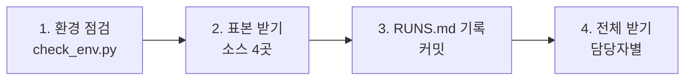

# BioRag-VertorDB — 생의학 문서 RAG·벡터 DB (1단계: 코퍼스 다운로드)

OCR 없이 기계가 바로 읽는 문서(JATS XML·JSON)만으로 생의학 RAG 코퍼스를 만든다. 이 저장소에는 1차 다운로드 스크립트와 절차만 들어 있고, 데이터는 올리지 않는다.

## 바로 따라하기 (팀 서버 server179-96)

스크립트는 각자 홈 폴더에 받고, 데이터는 공유 디스크 `/hdd_2/bio-data` 한곳에 받는다. 아래 블록을 위에서부터 그대로 복사해 실행한다.

**처음 한 번**

```bash
# 0) biodata 그룹이 보이는지 확인한다(없으면 다시 로그인하거나 newgrp biodata)
id

# 1) 내 홈 폴더에 저장소를 받는다
#    Private 저장소라 GitHub 아이디와 비밀번호 대신 토큰을 묻는다(아래 '토큰 만들기')
git clone https://github.com/Joonmo-Ahn/BioRag-VertorDB.git /home/$USER/BioRag-VertorDB

# 2) 데이터 저장 위치와 기록에 남을 이름을 셸 설정에 넣는다
echo 'export BIO_DATA_ROOT=/hdd_2/bio-data' >> /home/$USER/.bashrc
echo "export BIO_OPERATOR=$USER" >> /home/$USER/.bashrc
source /home/$USER/.bashrc

# 3) 커밋에 남을 이름과 이메일을 정한다
git config --global user.name "내 이름"
git config --global user.email "내 GitHub 이메일"

# 4) 환경 점검: '[통과] 저장 위치에 파일을 만들 수 있다'가 나오면 된다
python3 /home/$USER/BioRag-VertorDB/scripts/check_env.py
```

- **토큰 만들기**: GitHub 오른쪽 위 프로필 → Settings → Developer settings → Personal access tokens → Fine-grained tokens → Generate new token. Repository access에서 `Joonmo-Ahn/BioRag-VertorDB`만 고르고, Permissions의 Contents를 Read and write로 한다. `git clone`이 Password를 물으면 이 토큰을 붙여 넣는다.
- 매번 토큰을 묻지 않게 하려면 `git config --global credential.helper store`를 한 번 실행한다. 토큰이 `/home/$USER/.git-credentials`에 평문으로 저장되므로 공용 계정에서는 쓰지 않는다.

**받을 때마다**

```bash
# 1) 최신 스크립트와 기록을 받는다
git -C /home/$USER/BioRag-VertorDB pull

# 2) tmux 안에서 내 담당 명령을 실행한다(아래 '지금 할 일' 표, 끊겨도 계속 돈다)
tmux new -s 작업이름

# 3) 끝나면 스크립트가 출력한 기록 줄을 RUNS.md '다운로드 기록' 표 맨 아래에 붙여 넣는다
nano /home/$USER/BioRag-VertorDB/RUNS.md

# 4) 기록을 올린다
git -C /home/$USER/BioRag-VertorDB add RUNS.md
git -C /home/$USER/BioRag-VertorDB commit -m "RUNS: 소스 이름 날짜"
git -C /home/$USER/BioRag-VertorDB push
```

- `push`가 거절되면(다른 사람이 먼저 올림) `git -C /home/$USER/BioRag-VertorDB pull --rebase`를 실행한 뒤 다시 `push`한다.
- AWS CLI(`aws s3 sync`)로 받은 것은 기록 줄이 출력되지 않는다. 파일 수(`find 폴더 -type f | wc -l`)와 용량(`du -sh 폴더`)을 재서 같은 형식으로 직접 적는다.

**지금 할 일 (2026-10-23 기준, 진행 현황은 [RUNS.md](RUNS.md) 요약표)**

| 담당 | 상태 | 다음 명령 |
|---|---|---|
| 담당 1 PMC | 메타데이터 sync 진행 중(lucia, 10-24 03:00 무렵 완료 추정) | 끝나면 같은 sync를 한 번 더 실행한 뒤 `python3 /home/$USER/BioRag-VertorDB/scripts/pmc.py grade`, 이어서 `python3 /home/$USER/BioRag-VertorDB/scripts/pmc.py fetch --grade A --workers 32` |
| 담당 1 선택 OpenAlex | 완료(jmahn, 3,131개·704G) | 없음 |
| 담당 2 PubMed | 완료(hyungil, 69.9GB) | 없음 |
| 담당 3 openFDA·ClinicalTrials.gov | 완료(lucia, 1.6GB·2.0GB) | 없음 |

- 같은 폴더를 두 사람이 동시에 sync하지 않는다. 담당 1의 PMC 메타데이터는 lucia가 실행 중이므로 끝날 때까지 기다린다.
- 이전에 zip으로 받은 `/hdd_2/bio-data/src/bio-rag-data`는 그대로 두어도 된다. 새 작업은 홈 폴더의 저장소에서 한다.

## 한눈에 보기

- 1차로 받는 곳은 네 곳이다. PMC OA Subset(논문 전문), PubMed(초록·서지), openFDA(의약품 라벨), ClinicalTrials.gov(임상시험 등록 문서)이며, 네 곳 모두 계정 없이 받는다.
- 표본을 먼저 받아 확인하고, 문제가 없으면 담당을 나눠 전체를 받는다.
- 원문 노출 등급 A(원문을 화면에 보여 줘도 되는 라이선스: CC0·CC BY·CC BY-SA·퍼블릭 도메인) 문서를 먼저 받는다.
- 스크립트는 Python 3.9 이상 표준 라이브러리만 쓴다. `pip install`이 필요 없다.
- 데이터는 팀 공유 디스크 한곳(`BIO_DATA_ROOT`)에 받고, 받을 때마다 [RUNS.md](RUNS.md)에 한 줄을 남긴다.



## 빠른 시작(표본)

```bash
# 1) 저장소 받기
git clone https://github.com/Joonmo-Ahn/BioRag-VertorDB.git
cd BioRag-VertorDB

# 2) 저장 위치와 이름 정하기(팀 공유 디스크 권장, 비워 두면 저장소 안 data/)
export BIO_DATA_ROOT=/공유디스크/bio-data
export BIO_OPERATOR=홍길동

# 3) 환경 점검: Python 버전, 여유 공간, 사이트 접속
python3 scripts/check_env.py

# 4) 표본 받기
python3 scripts/pmc.py sample                   # PMC 메타데이터 2,000건을 판정하고 A 등급 본문 200편을 받는다
python3 scripts/pubmed.py sample                # PubMed 기준본 첫 파일 1개를 받고 레코드 수를 센다
python3 scripts/openfda.py download --parts 1   # openFDA 의약품 라벨 첫 조각을 받는다
python3 scripts/ctgov.py sample                 # 임상시험 등록 문서 1,000건을 받는다
```

- `make`가 있으면 `make check`와 `make sample`로 같은 일을 한다.
- Windows PowerShell에서는 `export` 대신 `$env:BIO_DATA_ROOT="D:\bio-data"`처럼 설정하고, `python3` 대신 `python`이나 `py`를 쓴다.
- 스크립트는 끝날 때 RUNS.md에 붙일 한 줄을 출력한다. 그 줄을 붙여 넣고 커밋하라.
- 중간에 끊겨도 같은 명령을 다시 실행하면 받은 파일은 건너뛰고 이어 받는다.
- 각 스크립트의 옵션은 `python3 scripts/pmc.py --help`처럼 확인한다.

## 1차 다운로드 대상

받는 방법은 두 가지다.

- **아마존 S3**: AWS에 올려 둔 공개 저장소에서 AWS CLI(`aws s3 sync`)로 받는다. 1차 대상은 계정과 요금 없이 `--no-sign-request`로 받는다. AWS CLI가 처음이면 [docs/aws-cli-practice.md](docs/aws-cli-practice.md)로 먼저 연습한다.
- **일반 다운로드**: 기관의 파일 서버나 API에서 HTTPS로 받는다. 저장소의 Python 스크립트가 처리한다.

원문 노출 등급은 RAG 답변 화면에 원문을 어디까지 보여 줄 수 있는지를 라이선스로 나눈 이 프로젝트의 자체 기준이다(A: 원문 공개 가능, B: 짧은 인용과 원문 링크만, C: 코퍼스에 넣지 않음). 용량 칸의 동그라미 번호는 표 아래 '산출 근거'의 같은 번호 항목이다.

| 순서 | 소스 | 받는 방법 | 받는 것 | 편수·건수 | 예상 용량 | 원문 노출 등급 |
|---|---|---|---|---|---|---|
| 1-1 | PMC OA Subset 메타데이터 | 아마존 S3(공개, 계정 불필요) | 논문 판본별 JSON | 800만 개 이상(판본 단위) | 내용 약 11GB, 디스크 사용량 약 33GB ① | 등급 판정에 쓴다 |
| 1-2 | PMC OA Subset 본문 | 아마존 S3(공개). 스크립트가 HTTPS로 받는다 | JATS XML·평문 | OA 8,087,649편(2026-10-13), 그중 A 등급 약 640만 편 ② | A 등급 약 1.1TB, OA 전체 약 1.4TB ③ | 논문마다 A 또는 B |
| 2 | PubMed 기준본 | 일반 다운로드(NCBI 파일 서버) | 초록·서지 XML(gzip) | 4,000만 건 이상, 파일 1,334개 | 압축 상태로 약 27~36GB ④ | B(초록에 출판사 저작권이 남을 수 있음) |
| 3 | openFDA 의약품 라벨 | 일반 다운로드(zip 파일) | 라벨 전문 JSON | 262,895건(2026-10-09 갱신) | 확인하지 못함 ⑤ | A(CC0 1.0) |
| 4 | ClinicalTrials.gov | 일반 다운로드(API) | 임상시험 등록 문서 JSON | 601,694건(2026-10-19) | JSON 원본 약 10.4GB, gzip으로 저장해 디스크는 더 작다 ⑥ | A(NLM 일반 약관, 출처 표시) |
| 선택 | OpenAlex 스냅샷 | 아마존 S3(공개, 계정 불필요) | 서지 메타데이터(DOI·인용·저널) | 약 5억 건 | 한 형식 약 750GB(두 형식 약 1.5TB) | 메타데이터 CC0 |

**저장 공간**: 1차 필수(1-1~4, openFDA 제외)는 약 1.2~1.5TB이고, OpenAlex 스냅샷까지 받으면 약 1.9~2.2TB다. 파싱·임베딩 결과도 쌓이므로 공유 디스크는 OpenAlex를 빼면 2TB 이상, 넣으면 3TB 이상을 잡는다.

산출 근거(모두 2026-10-19 계산):

- ① 메타데이터 표본 29개의 평균 1.33KB × 8,087,649로 내용 용량을 냈다. 작은 파일 하나가 디스크 블록 하나(보통 4KB)를 차지하므로 디스크 사용량은 8,087,649 × 4KB ≈ 33GB다.
- ② Europe PMC에서 CC BY가 OA의 79%(6,328,030 / 8,020,105건)라는 비율을 PMC에 그대로 적용한 참고값이다. 정확한 편수는 `pmc.py grade`가 출력하는 분포로 확정한다.
- ③ 논문 24편(PMC300만·600만·1,150만 번대, 대략 2010·2018·2024년 게재분)의 XML+평문 평균 169KB × 편수로 냈다. 최근 논문일수록 크다(1,150만 번대 평균 248KB, 600만 번대 100KB). 표본이 작아 오차가 크다. 같은 표본의 PDF 평균은 2.8MB로, PDF까지 받으면 약 23TB가 되어 받지 않는다.
- ④ 2015년 기준본 실측값(2,334만 건, 압축 15.9GB, 레코드당 679바이트, 마지막 파일들은 885바이트) × 4,000만 건으로 냈다. 최근 레코드는 참고문헌 목록 등이 늘어 실제는 더 클 수 있다. `pubmed.py sample`이 2026년 첫 파일 크기를 출력하므로 1,334를 곱해 다시 확인한다. 스크립트는 압축을 풀지 않고 읽는다.
- ⑤ `python3 scripts/openfda.py list`가 조각별 `size_mb` 합계를 출력한다. 받기 전에 확인한다.
- ⑥ ClinicalTrials.gov `/stats/size`가 밝힌 연구당 평균 17,290바이트 × 601,694건이다.

PubMed와 OpenAlex는 본문 코퍼스보다 메타데이터 정리(중복 제거, DOI·판본 맞추기)와 검색 평가용으로 먼저 쓴다.

**명령과 공식 안내**

- PMC OA Subset: `scripts/pmc.py`, `aws s3 sync` · [PMC Cloud Service](https://pmc.ncbi.nlm.nih.gov/tools/pmcaws/) · [저장소 README](https://pmc-oa-opendata.s3.amazonaws.com/README.txt)
- PubMed: `scripts/pubmed.py` · [Download PubMed Data](https://pubmed.ncbi.nlm.nih.gov/download/) · [2026 기준본 공지](https://www.nlm.nih.gov/pubs/techbull/jf26/jf26_PubMed_2026_BaselineRelease.html) · [2015 기준본 파일 통계](https://www.nlm.nih.gov/bsd/licensee/2015_stats/baseline_med_filecount.html)
- openFDA: `scripts/openfda.py` · [다운로드 안내](https://open.fda.gov/apis/downloads/) · [download.json 필드 설명](https://open.fda.gov/apis/download-api-fields/) · [라이선스](https://open.fda.gov/license/)
- ClinicalTrials.gov: `scripts/ctgov.py` · [API 안내](https://clinicaltrials.gov/data-api/api) · [연구 크기 통계](https://clinicaltrials.gov/api/v2/stats/size)
- OpenAlex: `aws s3 sync` · [스냅샷 안내](https://developers.openalex.org/download/download-to-machine)

### 2차 대상(참고)

1차를 마친 뒤 받는다. 요청자 부담 저장소는 받는 쪽이 요금을 내므로 팀 AWS 계정 자격 증명이 필요하다.

| 소스 | 받는 방법 | 편수·건수 | 예상 용량 | 원문 노출 등급 |
|---|---|---|---|---|
| bioRxiv 전문(MECA) | 아마존 S3 요청자 부담(팀 계정, `--request-payer requester`) | 354,802편(2026-10 조사) | 확인하지 못함(`aws s3 ls --recursive --summarize`로 확인) | B(재호스팅 금지) |
| arXiv q-bio 원문 | 아마존 S3 요청자 부담(팀 계정) | 2025년 3,229편 | 저장소 전체 약 9.2TB 중 q-bio 묶음만 고른다 | CC BY·CC0만 A |
| Europe PMC 보강 | 일반 다운로드(API) | 전문 11,962,492건 중 PMC에 없는 논문 | 확인하지 못함 | 논문마다 A 또는 B |
| KCI 논문정보(국문 초록) | 일반 다운로드(공공데이터포털 오픈 API) | 확인하지 못함 | 확인하지 못함 | A |
| Semantic Scholar s2orc_v2 | 일반 다운로드(API 키로 받은 링크) | 1,600만 편 | 확인하지 못함 | B |

## 전체 다운로드

표본이 정상이면 담당별로 전체를 받는다. 오래 걸리는 작업은 `tmux`나 `nohup`으로 실행해 접속이 끊겨도 계속 돌게 하라.

### 1. PMC OA Subset — 가장 크므로 먼저 시작한다

PMC 저장소(`s3://pmc-oa-opendata`)는 논문 판본마다 `PMC{ID}.{판본}/` 폴더에 `.xml`(JATS 전문)·`.txt`(평문)·`.json`(메타데이터)을 두고, `metadata/` 폴더에 JSON 사본을 모아 둔다. 라이선스별 폴더(`oa_comm` 등)는 2026-08-24 주에 없어졌으므로 JSON의 `license_code`로 등급을 나눈다.

1. AWS CLI를 설치한다([설치 안내](https://docs.aws.amazon.com/cli/latest/userguide/getting-started-install.html)). PMC는 AWS 계정 없이 `--no-sign-request`로 받는다. AWS CLI가 처음이면 [docs/aws-cli-practice.md](docs/aws-cli-practice.md)의 연습(논문 한 편 받기)부터 한다.

    ```bash
    # Linux x86_64 (sudo 없이 홈 폴더에 설치)
    curl "https://awscli.amazonaws.com/awscli-exe-linux-x86_64.zip" -o awscliv2.zip
    unzip awscliv2.zip && ./aws/install -i ~/.local/aws-cli -b ~/.local/bin
    aws --version
    ```

2. 작은 파일이 많으므로 동시 요청 수를 늘린다. 기본값은 10이다.

    ```bash
    aws configure set default.s3.max_concurrent_requests 32
    # AWS_PROFILE로 팀 프로필을 정해 두었다면 그 프로필에 설정한다
    aws configure set s3.max_concurrent_requests 32 --profile bio-team
    ```

3. 메타데이터 전체를 받는다. 논문 판본마다 JSON이 하나씩, 800만 개가 넘는다.

    ```bash
    aws s3 sync --no-sign-request --region us-east-1 --only-show-errors \
      s3://pmc-oa-opendata/metadata/ "${BIO_DATA_ROOT:-data}/raw/pmc/metadata/"
    ```

    - 내용은 약 11GB, 디스크 사용량은 약 33GB다(위 표의 ①). inode도 800만 개 넘게 필요하다. `check_env.py`가 사용 가능한 inode 수를 보여 준다.
    - `--only-show-errors`는 파일마다 찍히는 진행 줄을 숨기고 오류만 보여 준다.
    - `sync`는 받은 파일을 건너뛰므로 끊기면 같은 명령을 다시 실행한다.

4. 등급을 판정한다. 옛 종이 논문을 스캔해 OCR로 만든 본문(`is_historical_ocr`)과 철회 논문(`is_retracted`)은 뺀다.

    ```bash
    python3 scripts/pmc.py grade
    ```

    - 결과는 `filtered/pmc_docs.csv`(논문별 등급)와 `meta/pmc_license_distribution.json`(라이선스 분포)이다. 이 분포가 A 등급 규모를 확정하는 근거다.
    - 철회 논문의 영향을 재는 실험을 할 계획이면 `--keep-retracted`를 붙인다. 철회 논문을 빼지 않고 `is_retracted` 열로 표시만 한다.
    - `B_review` 값이 나오면 표준 CC 코드가 아니라는 뜻이다. 값을 확인해 `scripts/pmc.py`의 `A_CODES`나 `B_CODES`에 더하고 PR로 올린다.

5. A 등급 본문을 받는다. 메타데이터에 적힌 MD5로 파일마다 손상을 확인한다.

    ```bash
    python3 scripts/pmc.py fetch --grade A --workers 32
    ```

    - A 등급 XML+평문은 약 1.1TB로 추정한다(위 표의 ②·③). 평문이 필요 없으면 `--formats xml`을 붙여 약 3분의 2로 줄인다. 일부만 받으려면 `--limit 10000`을 붙인다.
    - PDF는 받지 않는다. XML과 평문이 있으면 OCR도 PDF 파싱도 필요 없기 때문이다.

### 2. PubMed 기준본과 갱신본

```bash
python3 scripts/pubmed.py baseline     # pubmed26n0001~1334, 파일마다 .md5로 확인
python3 scripts/pubmed.py updates      # 일일 갱신본(pubmed26n1335부터)
```

- NLM은 기준본을 전부 적재한 뒤 갱신본을 번호 순서대로 적용하라고 안내한다. 고쳐지거나 삭제된 레코드는 기존 레코드를 대체한다.
- 이용 조건은 [기준본 README](https://ftp.ncbi.nlm.nih.gov/pubmed/baseline/README.txt)에 있고, 파일을 받으면 그 조건에 동의한 것으로 본다. 데이터를 쓸 때 'Courtesy of the U.S. National Library of Medicine' 출처 표시가 필요하다.

### 3. openFDA 의약품 라벨

```bash
python3 scripts/openfda.py list        # 조각 수, 건수, 용량 확인
python3 scripts/openfda.py download    # 전체 조각 받기, zip 무결성 확인
```

- openFDA는 증분 갱신이 없다. 갱신되면 해당 항목의 파일을 전부 다시 받는다.
- 받은 시점의 파일 목록(`download.json`)을 `meta/`에 날짜별로 남긴다.

### 4. ClinicalTrials.gov

```bash
python3 scripts/ctgov.py size          # 등록 연구 수 확인
python3 scripts/ctgov.py all           # 전체, 끊기면 같은 명령으로 이어 받기
```

- 1,000건씩 받으므로 601,694건이면 약 602쪽이다. 요청 간격 1.5초 기준으로 기다리는 시간만 약 15분이고, 응답 시간은 따로 든다.
- 요청 한도를 공식 페이지에서 확인하지 못했으므로 분당 약 40건으로 보낸다. 외부 정리 문서에는 'IP당 분당 약 50건'으로 적혀 있다.

### 5. OpenAlex 스냅샷(선택, 약 750GB)

```bash
aws s3 ls --summarize --human-readable --no-sign-request --recursive "s3://openalex/data/jsonl/"
aws s3 sync "s3://openalex/data/jsonl" "${BIO_DATA_ROOT:-data}/raw/openalex/data/jsonl" --no-sign-request
```

- JSONL과 Parquet에 같은 내용이 들어 있으므로 한 형식만 받는다. 둘 다 받으면 약 1.5TB다.
- 무료 공개 스냅샷은 분기마다 나온다.

## 오늘 신청할 계정·키

1차 다운로드에는 필요 없지만 승인에 시간이 걸리거나 2차 작업에 쓰는 것들이다.

| 대상 | 쓰는 곳 | 신청 | 비고 |
|---|---|---|---|
| 공공데이터포털 '한국연구재단_KCI논문정보' | 국문 초록(2차 수집) | [공공데이터포털 3049042](https://www.data.go.kr/biz/dcat/metadata/3049042.do)에서 활용 신청 | 오픈 API(XML), 이용허락범위 '제한 없음' |
| OpenAlex 무료 API 키 | 스냅샷 이후 바뀐 레코드 확인 | [인증·가격 안내](https://developers.openalex.org/api-reference/authentication) | 키 없이 하루 US$0.10, 무료 키로 하루 US$1 |
| NCBI API 키 | E-utilities로 건수 확인 | [E-utilities 이용 지침](https://www.ncbi.nlm.nih.gov/books/NBK25497/) | 키 없이 초당 3건, 키가 있으면 초당 10건 |

Semantic Scholar 데이터셋 API 키는 2차 수집 때 신청한다([docs/runbook.md](docs/runbook.md)). 팀 AWS 계정 자격 증명(IAM)은 1차에는 필요 없고, 2차의 요청자 부담 저장소(bioRxiv·arXiv)에서 쓴다. 설정과 연습 방법은 [docs/aws-cli-practice.md](docs/aws-cli-practice.md)에 있다.

## 팀 작업 방식

1. **데이터는 한곳에 받는다.** 공유 서버나 NAS 경로를 `BIO_DATA_ROOT`로 정하고 모두 같은 값을 쓴다. 같은 데이터를 두 사람이 받지 않는다.
2. **담당을 나눈다.** 아래 표에 이름을 적고 커밋하라.
3. **받으면 기록한다.** 스크립트가 출력한 한 줄을 [RUNS.md](RUNS.md)에 붙여 넣고 커밋하라. 자세한 기록 JSON은 `$BIO_DATA_ROOT/logs/`에 자동으로 남고, 스크립트 버전(커밋 해시)도 함께 적힌다.
4. **데이터는 Git에 올리지 않는다.** `data/`는 `.gitignore`에 들어 있다.
5. **공유 서버에서는 `umask 002`로 실행한다.** 팀원도 받은 파일을 고치거나 이어 받을 수 있다.
6. **요청 한도를 지킨다.** HTTP 429(요청 과다)를 받으면 스크립트가 기다렸다가 다시 시도하고, 계속되면 멈춘다. IP를 바꾸는 식으로 우회하지 않는다.
7. **스크립트를 고치면 PR로 올린다.** 리뷰를 거쳐 합친 뒤 받아야 기록의 커밋 해시가 의미를 갖는다.
8. **AWS 자격 증명은 어디에도 올리지 않는다.** 액세스 키와 SSO 정보는 각자 홈 폴더의 `.aws/`에만 둔다. 저장소, RUNS.md, 메신저, 이슈에 붙이지 않는다. 공개 저장소(PMC·OpenAlex)는 자격 증명 없이 `--no-sign-request`로 받는다.

| 담당 | 맡는 소스 | 담당자 | 상태 |
|---|---|---|---|
| 1 | 아마존 S3 작업: PMC OA Subset(메타데이터 sync, 등급 판정, A 등급 본문 약 1.1TB), OpenAlex 스냅샷(선택, 약 750GB) |  | 시작 전 |
| 2 | PubMed 기준본·갱신본(약 27~36GB), OpenAlex·NCBI API 키 신청 |  | 시작 전 |
| 3 | openFDA 의약품 라벨, ClinicalTrials.gov(약 10GB 이하), 공공데이터포털 KCI 활용 신청 |  | 시작 전 |

## 저장 구조

```text
$BIO_DATA_ROOT/                  (기본값: 저장소 안 data/)
├── raw/
│   ├── pmc/metadata/            PMC 메타데이터 JSON (PMC{ID}.{판본}.json)
│   ├── pmc/articles/            PMC 본문 (PMC{ID}.{판본}/PMC{ID}.{판본}.xml, .txt)
│   ├── pubmed/baseline/         PubMed 기준본 (pubmed26n0001.xml.gz …)
│   ├── pubmed/updatefiles/      PubMed 갱신본
│   ├── openfda/drug/label/      openFDA 의약품 라벨 zip
│   └── ctgov/                   임상시험 등록 문서 (studies_p00001.json.gz …)
├── filtered/                    등급 판정 목록 (pmc_docs.csv, pmc_docs_sample.csv)
├── meta/                        라이선스 분포, openFDA 파일 목록 사본
└── logs/                        수집 기록 JSON, 받지 못한 파일 목록
```

## 받은 뒤 확인

- [ ] **건수 대조**: PMC는 판정 목록 편수를 8,087,649편과, PubMed는 파일 1,334개와, ClinicalTrials.gov는 `ctgov.py size` 값과 비교한다. 차이가 나면 `logs/`의 실패 목록부터 본다.
- [ ] **라이선스 분포**: `meta/pmc_license_distribution.json`을 팀과 공유한다. A 등급 규모와 논문의 데이터 가용성 항목에 그대로 쓴다.
- [ ] **B_review 정리**: 판정 목록에 `B_review`가 남아 있지 않게 한다.
- [ ] **무결성**: PMC(메타데이터의 MD5)와 PubMed(`.md5` 파일)는 스크립트가 확인한다. openFDA는 zip 검사를 한다. 실패한 파일은 같은 명령으로 다시 받는다.
- [ ] **표본 열람**: 소스마다 20건을 무작위로 골라 본문이 제대로 들어 있는지 사람이 연다.
- [ ] **기록**: RUNS.md에 줄을 남기고 커밋했는지 확인한다.

## 문제 해결

| 증상 | 원인 | 해결 |
|---|---|---|
| `check_env.py`에서 사이트가 '실패' | 방화벽·프록시가 주소를 막음 | 표의 주소를 네트워크 담당자에게 허용 요청한다. 회사 프록시를 쓰면 `HTTPS_PROXY` 환경변수를 설정한다 |
| `aws: command not found` | AWS CLI 미설치 | 위 '전체 다운로드 1'의 설치 명령을 실행하고, `~/.local/bin`이 `PATH`에 있는지 확인한다 |
| HTTP 429가 계속된다 | 요청 과다 | 몇 시간 뒤 다시 실행하고 `--workers` 값을 줄인다 |
| `check_env.py`에서 '저장 위치에 파일을 만들 수 없다' | 공유 폴더를 다른 사람이 만들어 내 계정에 쓰기 권한이 없다 | 아래 '공유 디스크 쓰기 권한'의 두 방법 가운데 하나로 권한을 준다. 권한을 받기 전에는 `export BIO_DATA_ROOT=$HOME/bio-data-sample`로 표본만 받는다 |
| 디스크나 inode가 모자란다 | PMC 메타데이터의 작은 파일 800만 개 이상 | 더 큰 볼륨으로 `BIO_DATA_ROOT`를 옮기거나, 표본 범위로 먼저 진행한다 |
| 받다가 끊겼다 | 네트워크 | 같은 명령을 다시 실행한다. 받은 파일은 건너뛴다 |
| `MD5 불일치` 경고 | 받는 중 손상 | 스크립트가 자동으로 다시 받는다. 계속되면 그 파일을 지우고 다시 실행한다 |

### 공유 디스크 쓰기 권한

셋이 한 서버의 같은 폴더(`BIO_DATA_ROOT`)에 받으려면 모두에게 쓰기 권한이 있어야 한다. 폴더를 처음 만든 사람만 쓸 수 있는 상태(권한 `drwxr-xr-x`)가 기본이다. `ls -ld <폴더>`로 주인과 권한을 확인하고 아래 방법 가운데 하나를 쓴다.

1. **ACL로 사람마다 권한 주기**: 폴더 주인이 실행하며 sudo가 필요 없다. `setfacl` 명령(`acl` 패키지)과 ACL을 지원하는 파일 시스템이 있어야 한다. 두 번째 줄의 기본 ACL은 앞으로 생길 파일에도 같은 권한을 준다.

    ```bash
    setfacl -R -m u:팀원아이디:rwX /공유디스크/bio-data
    find /공유디스크/bio-data -type d -exec setfacl -d -m u:팀원아이디:rwX {} +
    getfacl /공유디스크/bio-data     # 적용 확인
    ```

2. **팀 공유 그룹 만들기**: sudo 권한이 있는 사람이 실행한다. 그룹에 추가된 사람은 다시 로그인해야 적용되고, 받을 때는 `umask 002`로 실행해 새 파일에도 그룹 쓰기 권한이 붙게 한다.

    ```bash
    sudo groupadd -f biodata
    sudo usermod -aG biodata 팀원아이디        # 세 명 모두 각각 실행
    sudo chgrp -R biodata /공유디스크/bio-data
    sudo chmod -R g+rwX /공유디스크/bio-data
    sudo find /공유디스크/bio-data -type d -exec chmod g+s {} +   # 새 폴더가 그룹을 물려받게 한다
    ```

권한을 준 뒤 해당 팀원이 `python3 scripts/check_env.py`를 다시 실행해 '[통과] 저장 위치에 파일을 만들 수 있다'가 나오는지 확인한다.

## 더 읽을 것

- [docs/aws-cli-practice.md](docs/aws-cli-practice.md): 팀 IAM 자격 증명 설정, 공개 PMC 저장소로 하는 AWS CLI 연습, 메타데이터 전체 sync, 자격 증명 안전 수칙
- [docs/runbook.md](docs/runbook.md): 소스별 수집 방법, 요청 한도와 약관 요약표, 수집 기록 양식(조사 단계에서 만든 수집 런북 사본)
- [RUNS.md](RUNS.md): 팀 수집 기록

## 라이선스

- 이 저장소의 코드와 문서는 [MIT 라이선스](LICENSE)를 따른다.
- 스크립트로 받는 데이터는 MIT가 아니라 각 기관의 조건을 따른다. PMC 논문은 논문마다 다른 라이선스(`license_code`), PubMed는 NLM 이용 조건과 'Courtesy of the U.S. National Library of Medicine' 출처 표시, openFDA는 CC0 1.0, ClinicalTrials.gov는 NLM 일반 약관, OpenAlex 메타데이터는 CC0다.
